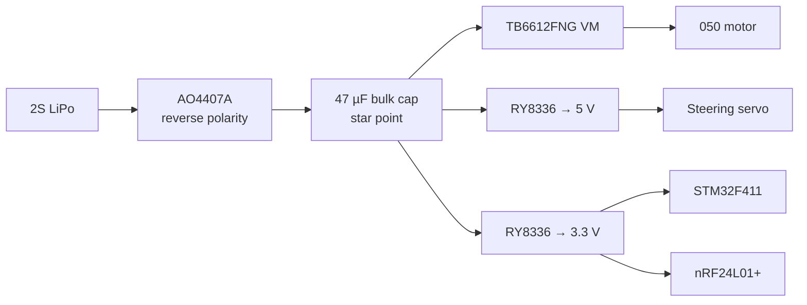

# STM32 Rock Crawler

A from-scratch radio control system for a 1/24-scale RC rock crawler, built around the STM32F411. It has two parts:

- **Crawler**: receives commands over a 2.4 GHz nRF24L01+ link and drives a brushed 050 motor through a TB6612FNG H-bridge plus a steering servo. Its custom board is **MITE v1**, shown above.
- **Controller**: a handheld transmitter that reads a 2-axis joystick and sends throttle and steering to the crawler.

Both firmwares are **bare-metal C++17**: no vendor HAL and no CubeMX-generated code. They're built on a register-level HAL ([STM32-HAL-Library](https://github.com/SySch415/STM32-HAL-Library), included as a submodule) and a custom nRF24L01+ driver.

> **Status**
>
> - Crawler and controller firmware run on prototype (two Black Pill boards).
> - **MITE v1** (custom crawler PCB): layout about 80% done, not yet fabricated. The firmware pin map has to be updated for the new board (see [Pin maps](#pin-maps)).
> - Controller PCB: schematic captured, layout not started.

---

## Contents

- [Repository layout](#repository-layout)
- [Building and flashing](#building-and-flashing)
- [Radio link](#radio-link)
- [Crawler control behavior](#crawler-control-behavior)
- [Pin maps](#pin-maps)
- [Hardware: MITE v1 crawler board](#hardware-mite-v1-crawler-board)
- [Hardware: controller](#hardware-controller)
- [First power-up checklist (MITE v1)](#first-power-up-checklist-mite-v1)
- [Roadmap](#roadmap)
- [License](#license)

---

## Repository layout

```
.
├── controller/            # Transmitter firmware (joystick → nRF24 TX)
│   ├── main.cpp
│   └── startup.cpp        # Vector table + Reset_Handler
├── crawler/               # Receiver firmware (nRF24 RX → motor + servo)
│   ├── main.cpp
│   └── startup.cpp
├── drivers/
│   ├── include/nrf24.hpp  # nRF24L01+ driver
│   └── src/nrf24.cpp
├── hal_lib/               # Submodule: SySch415/STM32-HAL-Library (GPIO, RCC, SPI, ADC, TIM)
├── hardware/
│   ├── crawler_schematic/     # KiCad project: MITE v1 crawler board
│   ├── controller_schematic/  # KiCad project: controller
│   └── original-schematic-STM32F411CEU6_WeAct_Black_Pill_V2.0.pdf  # reference
├── docs/images/           # README images
├── linker.ld              # STM32F411CE: 512 KB flash, 128 KB SRAM
└── CMakeLists.txt         # Builds controller.elf and crawler.elf
```

---

## Building and flashing

### Requirements

- `arm-none-eabi-gcc` toolchain
- CMake ≥ 3.20
- OpenOCD and an ST-Link (V2 or clone)

### Clone

The HAL is a git submodule, so clone recursively:

```bash
git clone --recursive https://github.com/SySch415/stm32-crawler.git
# or, in an existing clone:
git submodule update --init
```

### Build

```bash
cmake -B build
cmake --build build
```

This produces `controller.elf`/`.bin` and `crawler.elf`/`.bin` in `build/`.

### Flash

With the ST-Link connected to the target's SWD pins:

```bash
cmake --build build --target flash-crawler
cmake --build build --target flash-controller
```

Each target erases, writes to `0x08000000`, verifies, and resets the MCU through OpenOCD.

---

## Radio link

The controller transmits continuously, and the crawler listens on pipe 0.

| Setting               | Value                      |
| --------------------- | -------------------------- |
| RF channel            | 76 (2.476 GHz)             |
| Address               | `E7:E7:E7:E7:E7` (5 bytes) |
| Data rate / power     | 2 Mbps, 0 dBm              |
| CRC                   | 1 byte                     |
| Auto-ack / retransmit | Disabled                   |
| Payload               | 4 bytes, fixed length      |

**Payload format** (little-endian):

| Bytes | Field                 | Range                              |
| ----- | --------------------- | ---------------------------------- |
| 0–1   | Throttle (`uint16_t`) | 0–4095 (12-bit ADC), center ≈ 2048 |
| 2–3   | Steering (`uint16_t`) | 0–4095 (12-bit ADC), center ≈ 2048 |

---

## Crawler control behavior

**Throttle → TB6612FNG channel A**

- A dead band of ±100 counts around center (2048) gives **neutral**: AIN1 = AIN2 = high and PWM = 0, which puts the bridge in **short brake**. That's what keeps a crawler from rolling back down a slope.
- Above the dead band: **forward** (AIN1 high, AIN2 low), with duty scaled to the distance from center.
- Below the dead band: **reverse** (AIN1 low, AIN2 high).
- Motor PWM: timer ARR = 15999, prescaler = 0.

**Steering → servo**

- Standard RC servo frame of about 50 Hz, with a pulse of about **1.0–2.0 ms** mapped linearly from the steering axis.
- Within the steering dead band the servo holds **center (1.5 ms)**.

**Status LEDs** (prototype firmware): throttle forward/reverse and steering left/right indicators.

---

## Pin maps

### Prototype (Black Pill), matching the current firmware

**Crawler**

| Signal                    | Pin         | Peripheral     |
| ------------------------- | ----------- | -------------- |
| nRF CE                    | PA3         | GPIO           |
| nRF CSN                   | PA4         | GPIO           |
| nRF SCK                   | PA5         | SPI1 (AF5)     |
| nRF MISO                  | PA6         | SPI1 (AF5)     |
| nRF MOSI                  | PA7         | SPI1 (AF5)     |
| Motor PWM (PWMA)          | PB6         | TIM4_CH1 (AF2) |
| AIN1                      | PB7         | GPIO           |
| AIN2                      | PB8         | GPIO           |
| Servo PWM                 | PB4         | TIM3_CH1 (AF2) |
| LED throttle up / down    | PA0 / PA1   | GPIO           |
| LED steering left / right | PA11 / PA12 | GPIO           |

**Controller**

| Signal                | Pin             | Peripheral |
| --------------------- | --------------- | ---------- |
| Joystick Y (throttle) | PA0             | ADC1_IN0   |
| Joystick X (steering) | PA1             | ADC1_IN1   |
| nRF CE / CSN          | PA3 / PA4       | GPIO       |
| nRF SCK / MISO / MOSI | PA5 / PA6 / PA7 | SPI1 (AF5) |

### MITE v1 board (as routed, pending firmware update)

> ⚠️ Several pins moved during PCB layout. **The crawler firmware has to be updated before it runs on MITE v1.**

| Signal           | Pin           | Peripheral        | Changed? |
| ---------------- | ------------- | ----------------- | -------- |
| nRF CE           | PA7           | GPIO              | ✱        |
| nRF CSN          | PA6           | GPIO              | ✱        |
| nRF SCK          | PA5           | SPI1_SCK          |          |
| nRF MISO         | PA3           | ⚠️ under review   | ✱        |
| nRF MOSI         | PA4           | ⚠️ under review   | ✱        |
| nRF IRQ          | not connected | (polled over SPI) |          |
| Motor PWM (PWMA) | PB4           | TIM3_CH1          | ✱        |
| AIN1             | PB6           | GPIO              | ✱        |
| AIN2             | PB5           | GPIO              | ✱        |
| Servo PWM        | PB7           | TIM4_CH2          | ✱        |
| Status LED       | PC13          | GPIO (active low) | ✱        |
| SWDIO / SWCLK    | PA13 / PA14   | SWD               |          |

---

## Hardware: MITE v1 crawler board

A 40 × 50 mm, 4-layer board that replaces the prototype's Black Pill, nRF module, H-bridge breakout and regulators. The KiCad project is in [`hardware/crawler_schematic/`](hardware/crawler_schematic).

### Main parts

| Block                       | Part                                             | Notes                                                                                  |
| --------------------------- | ------------------------------------------------ | -------------------------------------------------------------------------------------- |
| MCU                         | STM32F411CEU6 (UFQFPN48)                         | 25 MHz HSE crystal, BOOT0 and reset buttons                                            |
| Radio                       | nRF24L01+ (bare QFN-20)                          | 16 MHz crystal, Johanson 2450AT43F0100 chip antenna, Nordic reference matching network |
| Motor driver                | TB6612FNG (SSOP-24)                              | Channel A only; VM from battery                                                        |
| Reverse polarity protection | AO4407A P-channel MOSFET                         | High-side, gate to GND through 10 kΩ                                                   |
| Servo rail                  | RY8336 synchronous buck → 5 V                    | 4.7 µH molded inductor                                                                 |
| Logic / RF rail             | RY8336 synchronous buck → 3.3 V                  | 4.7 µH molded inductor                                                                 |
| Motor bulk capacitor        | 47 µF aluminum electrolytic                      | At the H-bridge VM pins                                                                |
| Battery                     | 2S LiPo (7.4 V nominal, 8.4 V full)              | JST-PH                                                                                 |
| Connectors                  | JST-PH battery, JST-PH motor, 1×3 servo, 1×4 SWD |                                                                                        |

### Power architecture



**Why it's arranged this way:**

- **The servo and the logic run on separate rails.** On the prototype, servo current spikes and radio TX bursts browned out the shared 3.3 V supply. The servo now has its own 5 V buck, and the 3.3 V buck runs straight from the battery.
- **The STM32 and nRF share one 3.3 V rail**, so neither chip can be back-powered through the SPI pins during power-up or power-down.
- **The battery supply splits at the bulk capacitor** (star point), so motor switching current doesn't share copper with the buck inputs.

### Stackup and layout rules

JLCPCB **JLC04161H-3313**, 1.6 mm, impedance controlled.

| Layer       | Use                                |
| ----------- | ---------------------------------- |
| L1 (F.Cu)   | Components, signals, motor current |
| L2 (In1.Cu) | Solid GND plane, no routing        |
| L3 (In2.Cu) | 3.3 V pour                         |
| L4 (B.Cu)   | Signals                            |

| Item                                 | Value                                  |
| ------------------------------------ | -------------------------------------- |
| Default track / clearance            | 0.2 mm / 0.2 mm                        |
| Motor nets (BAT_IN, +BATT, AO1, AO2) | 2.0 mm (sized for ~5 A stall)          |
| Power nets (+3.3V, +5V)              | 0.5 mm, necked down at fine-pitch pins |
| RF feed (50 Ω, grounded coplanar)    | 0.40 mm width, 0.25 mm gap             |
| Vias                                 | 0.6 mm pad / 0.3 mm drill              |
| Copper to board edge                 | 0.5 mm                                 |

### RF notes

- The antenna has a copper keepout on all four layers. Only the feed trace enters it, on F.Cu.
- Following Nordic's product specification, the nRF24L01+ **exposed die pad is left unconnected**. Ground goes through the VSS pins, each with its own via.
- Do a range test against a known-good nRF24 module before final assembly.

### Fabrication and assembly

- **Fab:** JLCPCB, 4 layers, 1.6 mm, **JLC04161H-3313 with impedance control**, with a top-side stencil.
- **Assembly:** in-house. Solder paste and stencil, hot-plate reflow, **top side only**. Headers are hand-soldered afterward. QFN bridges are reworked with hot air.
- The [Interactive HTML BOM](https://github.com/openscopeproject/InteractiveHtmlBom) KiCad plugin is used as the placement map.

### SWD header (J3)

| Pin | Signal       |
| --- | ------------ |
| 1   | +3.3 V       |
| 2   | SWDIO (PA13) |
| 3   | SWCLK (PA14) |
| 4   | GND          |

---

## Hardware: controller

Currently a prototype-level build. The KiCad schematic is in [`hardware/controller_schematic/`](hardware/controller_schematic), and the PCB isn't laid out yet.

| Part                           | Notes                         |
| ------------------------------ | ----------------------------- |
| DFRobot Black Pill (STM32F411) | MCU board                     |
| nRF24L01+ module               | SPI1                          |
| 2-axis analog joystick         | Throttle (Y) and steering (X) |
| 18650 Li-ion cell              | Power                         |
| MT3608 boost module            | 5 V for the Black Pill        |

---

## First power-up checklist (MITE v1)

1. Inspect under magnification: QFN bridges, and the orientation of the electrolytic cap, MOSFET and LEDs.
2. Power it from a **current-limited bench supply** (about 7.4 V, 200 mA limit) before connecting a LiPo.
3. Measure the rails: **3.3 V** and **5 V**.
4. Measure STM32 **VCAP_1 ≈ 1.2 V**, which confirms the internal regulator is running.
5. Connect the ST-Link and check that the MCU is detected (`openocd -f interface/stlink.cfg -f target/stm32f4x.cfg`).
6. Bring up the subsystems one at a time: radio, then servo, then motor (wheels off the ground).

---

## Roadmap

- [ ] Finish MITE v1 routing and DRC, then fabricate
- [ ] Update the crawler firmware pin map for MITE v1
- [ ] **Failsafe:** stop the motor and center the steering if no packet arrives within a timeout
- [ ] Range test of the chip antenna vs. an nRF24 module
- [ ] Controller PCB layout
- [ ] Battery voltage monitoring and low-voltage cutoff

---

## License

[MIT](LICENSE) © 2026 Simon Schmidt
